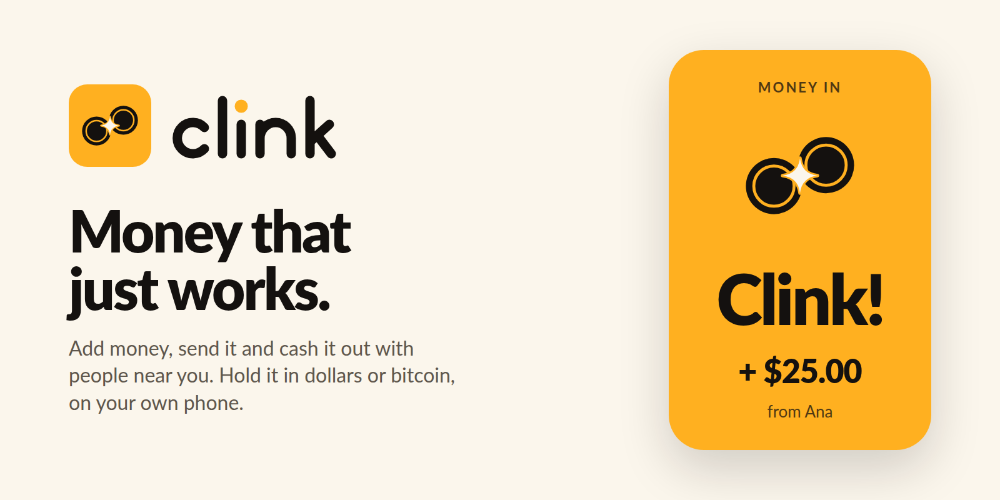

# Clink brand

**Clink** is the sound of a coin dropping into a jar, and of two glasses touching. The app plays it when money lands, so the name and the best moment in the app are the same thing. You don't need English to get it: the sound means the same in Lagos, Lima and Jakarta.

**Tagline:** Money that just works.

## Logo

Two coins meeting edge to edge, tilted like two glasses touching, with a spark where they touch. The spark is a quiet nod to Spark, the wallet underneath.

| File | Use |
| --- | --- |
| `assets/brand/logo-tile.svg` / `.png` | The logo anywhere the background is unknown (gold rounded tile) |
| `assets/brand/mark.svg` | The mark alone, on gold |
| `assets/brand/wordmark.svg` | Lowercase "clink" in ink; the dot on the i is a gold coin |
| `assets/brand/wordmark-cream.svg` | The wordmark on dark backgrounds |
| `assets/icon.png` | iOS and store icon |
| `assets/adaptive-icon.png`, `assets/monochrome-icon.png` | Android adaptive and themed icons |
| `assets/splash.png`, `assets/splash-dark.png` | Launch screen, light and dark |
| `assets/favicon.png` | Web |

All of these come from `scripts/brand-assets.mjs`. Change a shape or colour there and rerun it; the in-app `Logo`, `Wordmark` and `Spark` in `src/ui/components.tsx` draw the same shapes.

Don't recolour the coins, put the mark on a busy photo, or stretch it. On gold, the wordmark's dot goes ink.

## Colour

| Token | Light | Dark | Use |
| --- | --- | --- | --- |
| Gold (`primary`) | `#ffb020` | `#ffb020` | Buttons, switches, the Clink moment. Always with ink on top |
| Gold text (`primaryInk`) | `#8f5500` | `#ffc24d` | Brand-coloured text and icons (gold itself is too light to read) |
| Ink (`text`, `hero`) | `#14110f` | `#fbf6ec` | Text; the balance card |
| Cream (`bg`) | `#fbf6ec` | `#14110f` | Background |
| Money in (`positive`) | `#177a4a` | `#3cc27e` | Only for money arriving |
| Money out (`accent`) | `#b83c27` | `#ff7a61` | Cash out, sell, pending |

Never show "up" or "down" by colour alone. Red means *up* in much of East Asia, so pair colour with a + or − sign or an arrow.

## Sound

`assets/sounds/clink.wav`: two quick glassy strikes, G6 then D7, under a second. It plays only when money lands (money in, money added, cashed out), together with the success haptic, mixes with other audio, and stays quiet when the phone is on silent. Don't use it for anything else, or it stops meaning "money".

## Voice

- Plain, short words that translate cleanly: **Add money, Cash out, Send, Ask**.
- No idioms, slang or puns that only work in English. The name stays English everywhere; everything else gets translated.
- Bitcoin words (sats, Lightning, Nostr, relays) stay in *Your keys, your money*, not on the main screens.
- The stable balance is **Dollars**; the other is **Bitcoin**. Show both in local currency first. "Holds its value in dollars", never "your money never changes".
- Celebrate money arriving ("Clink!"), not spending.

## Names and symbols to avoid in these markets

- Pigs and piggy banks: offensive in Indonesia, Pakistan, Malaysia, North Africa.
- "Coco": *cocô* is poop in Brazil.
- "Penny": close to *pene* in Spanish.
- "Papaya": *dar papaya* is making yourself easy to rob, in Colombia.
