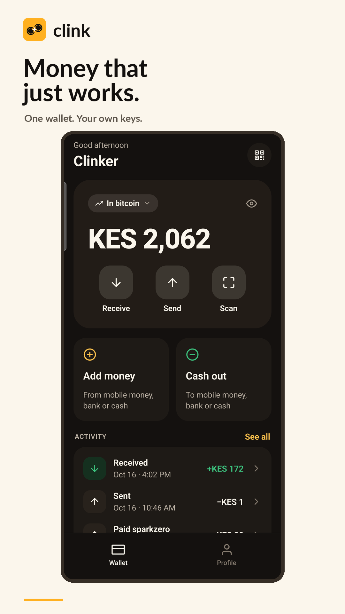
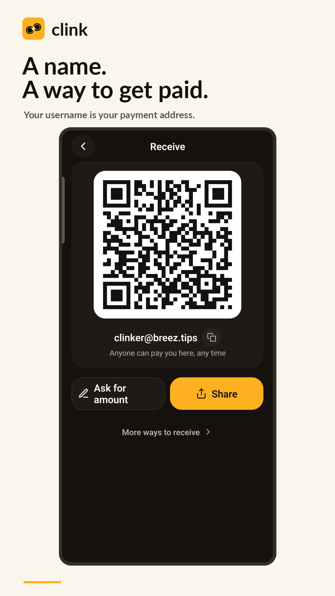
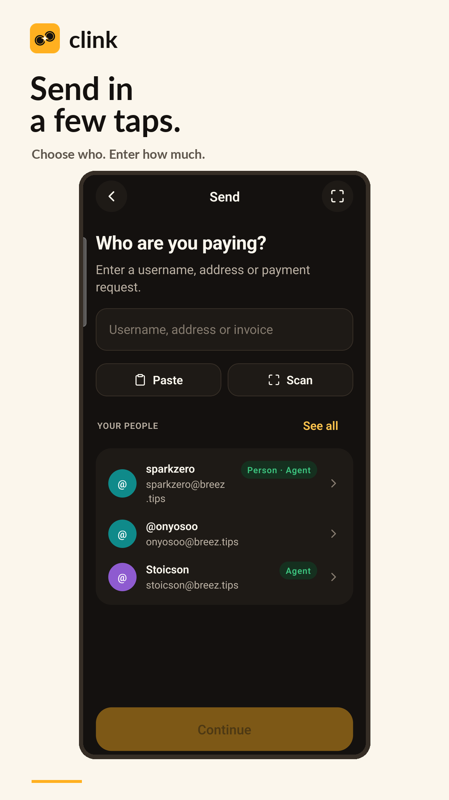
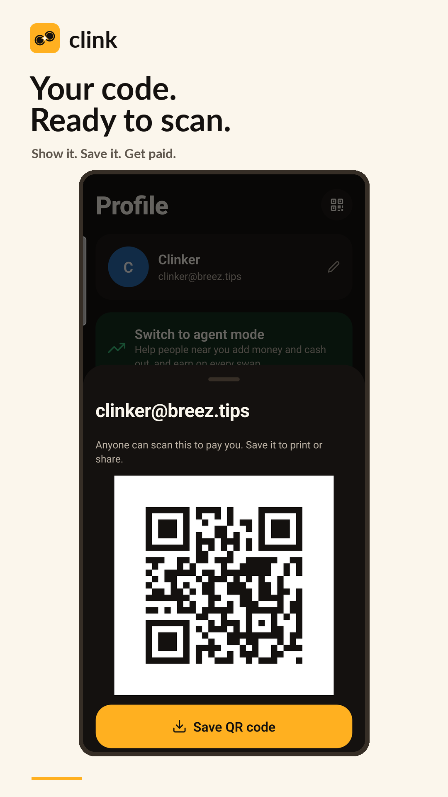
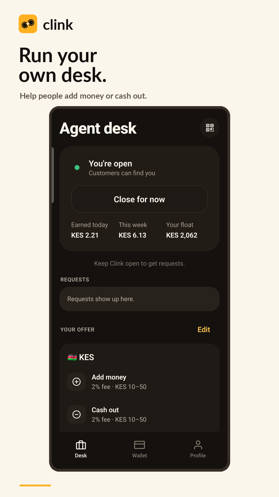
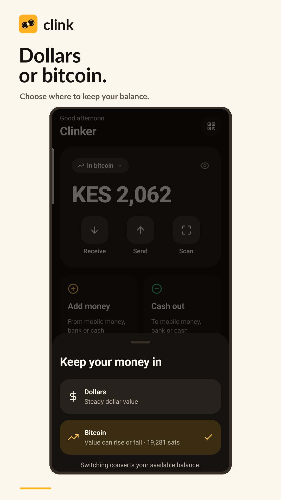
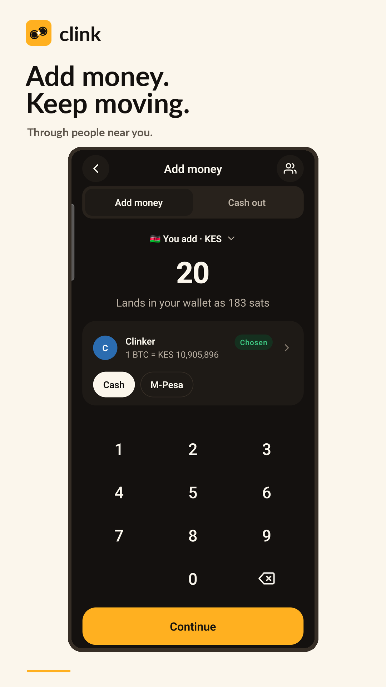
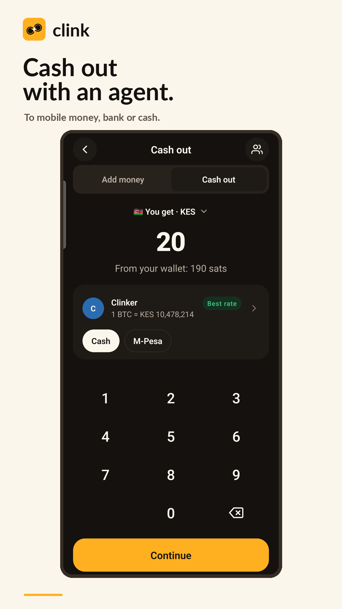

# Clinker store screenshots

Eight captioned **1080 × 1920 PNGs**, using Clink's cream, ink and gold palette.
The demo profile is **Clinker** and its payment address is **clinker@breez.tips**.

| Wallet | Receive | Send | Payment QR |
| --- | --- | --- | --- |
| [](01-wallet.png) | [](02-receive.png) | [](03-send.png) | [](04-payment-qr.png) |

| Agent desk | Balance choice | Add money | Cash out |
| --- | --- | --- | --- |
| [](05-agent.png) | [](06-balance.png) | [](07-add-money.png) | [](08-cash-out.png) |

## Captures

Captured on 16 October 2026 from a Samsung Galaxy S23 at **1080 × 2340**.
Sources are in [../screenshots](../screenshots). App content, balances, rates,
contacts and QR values are genuine device captures. The artwork adds a frame
and captions and crops the Android status/navigation bars; it does not change
app content.

Most screens use **Clink Dev** with the Clinker demo identity. Add money and
Cash out were captured in the production installation acting as the customer,
with the live Clinker desk selected at **KES 20**. Both show an available agent
and an enabled Continue button. These captures stop before submitting a swap.
The desk used manual acceptance during capture and was then closed, with its
original auto-accept setting restored.

The raw desk screenshot shows the desk open at capture time. The screenshots
are examples, not a promise of ongoing agent availability or fixed rates.
Android notification icons were temporarily hidden and restored afterward.
No recovery words or private keys were captured.

## Rebuild

From the repository root, with Python and Pillow installed:

```sh
python3 scripts/compose-store-screenshots.py
python3 scripts/compose-screenshots.py docs/user-mode.png \
  "Wallet=docs/screenshots/01-home.png" \
  "Receive=docs/screenshots/02-receive.png" \
  "Send=docs/screenshots/09-send.png" \
  "Add money=docs/screenshots/03-add-money.png" \
  "Cash out=docs/screenshots/13-cash-out.png"
python3 scripts/compose-screenshots.py docs/agent-mode.png \
  "Agent desk=docs/screenshots/07-desk.png" \
  "Your offer=docs/screenshots/08-offer.png" \
  "Agent QR=docs/screenshots/12-agent-qr.png" \
  "Profile=docs/screenshots/06-profile.png"
```

`zapstore.yaml` uses the captioned images for future store publications.
